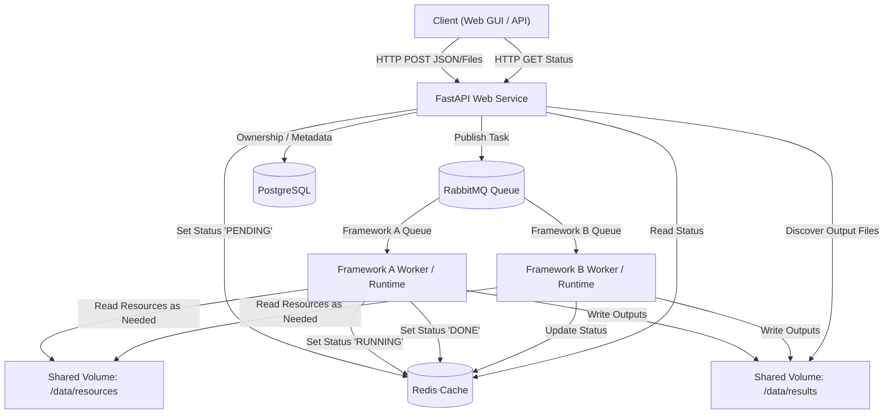
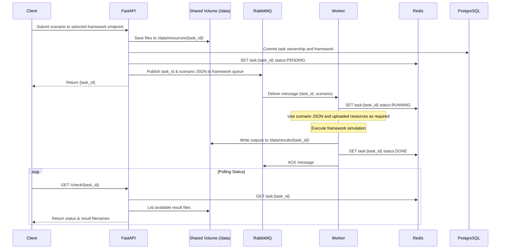

# NFDI4Energy Simulation Server

Run simulations across multiple frameworks through a shared web application.
After signing in, choose a framework to submit scenarios, inspect task status and
history, and download results.

For local setup, follow the [deployment guide](docs/deployment-guide.md).

## Frameworks

- DaceDSX
- Mosaik

## Architecture

Frameworks share the Svelte frontend, FastAPI backend, authentication, PostgreSQL
task ownership and metadata, Redis runtime status, and shared storage. RabbitMQ
routes tasks to framework-specific queues and workers. Kafka carries DaceDSX
simulation events.



## Sequence Flow

The following sequence illustrates the shared submission flow and a successful run:



## Prerequisites

- Docker, Minikube, kubectl, Git, Python 3, OpenSSL, curl, and tar. Node.js/npm is
  only needed to run the frontend outside Docker; the web image builds the dashboard itself.
- The build script installs Helm 3 locally if Helm is missing; no `sudo` needed.
- OIDC credentials are optional for local development.

## Getting Started

For local use without OIDC, create `.env` only if it does not already exist:

```bash
test -f .env || cp .env.example .env
chmod 600 .env
openssl rand -hex 32
```

Set `SIMAAS_ENV=development` and `AUTH_DISABLED=true` in `.env`, use the generated
value for `SESSION_SECRET`, and set `DB_PASSWORD` (keep the existing password if the
database already exists). `OIDC_CLIENT_ID` and `OIDC_CLIENT_SECRET` can be left blank.
The web application refuses to start with `AUTH_DISABLED=true` unless
`SIMAAS_ENV=development`, so the bypass cannot reach a production deployment by accident.

Follow the [deployment guide](docs/deployment-guide.md) for TLS certificates,
Minikube, and the data mount. Then, from the repository root:

```bash
bash build-minikube.sh
```

Keep the data mount running. After deployment, forward the shared web application:

```bash
kubectl -n ingress-system port-forward service/simaas-ingress 5001:5001 8002:8002
```

With the local defaults, open **https://localhost:5001**, sign
in, and choose a framework.
In local mode, **Sign in** opens a shared development account without an external
login. Use this mode only on your own trusted machine, not a public deployment.
To use OIDC instead, set `AUTH_DISABLED=false`, supply the OIDC credentials in
`.env`, and rerun the build script. The OIDC client must be registered with the
redirect URI `https://<host>/auth/callback` (`OIDC_REDIRECT_URI`).

Open Mosaik's **Create scenario** action to access the editor at
**https://localhost:8002/mosaik/** using your current login. Both forwarded ports
reach the authenticated web gateway, not the internal editor directly.

On a server, set `SIM_SERVER_HOST` to its public hostname and `SIM_SERVER_URL` to
its HTTPS origin, for example `https://simulation.example.org:5001`. Use a matching
TLS certificate and OIDC. The editor link follows the browser hostname on port
8002; no server address is embedded in the frontend. See the deployment guide for
network exposure; the commands above bind only to your local machine.

Inputs are stored under `/data/resources/{task_id}/`; results are saved under
`/data/results/{task_id}/`. Keep credentials out of Git and restrict scenario
authoring and execution to trusted users.

## License

This project is licensed under the GNU Affero General Public License v3.0
(AGPL-3.0) — see the [LICENSE](LICENSE) file for details.

It started as a fork of
[open-plan-tool/simulation-server](https://github.com/open-plan-tool/simulation-server),
developed by the [Reiner Lemoine Institut](https://reiner-lemoine-institut.de/en/)
in the scope of the open_plan project, and has since been substantially
rewritten and extended.
